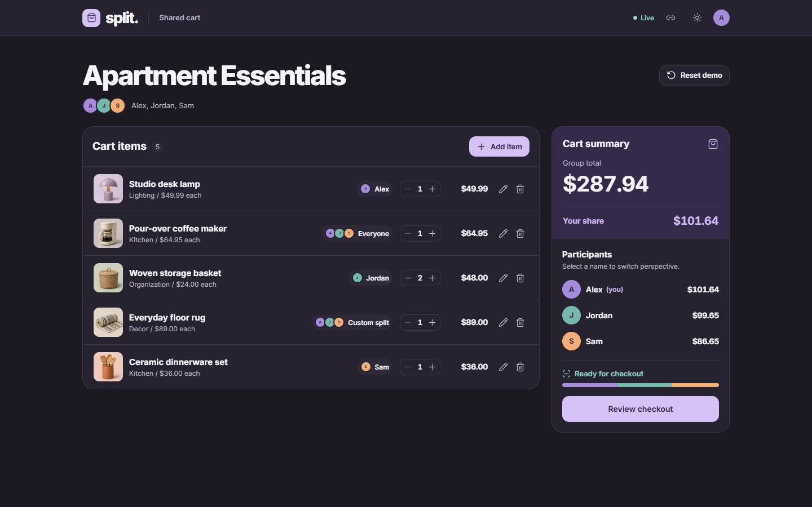
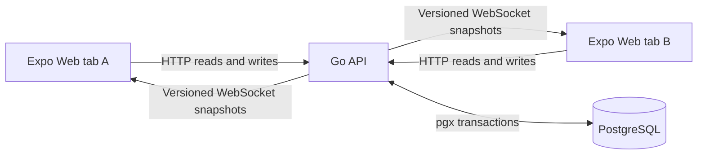

# split.

One cart. Multiple people. Zero awkward math.

Split is a shared shopping cart for groups. Add what you need, decide how to divide each item, and see everyone's share update live. Run a demo checkout to get an itemized receipt.

**Product demo video** · Recording slot reserved.



[Allocation editor](docs/screenshots/allocation.jpg) · [Checkout review](docs/screenshots/checkout.jpg) · [Shared receipt](docs/screenshots/receipt.jpg)

## What you can do

- Open a seeded Apartment Essentials demo or create an empty cart.
- Share a cart link and switch between Alex, Jordan, and Sam.
- Assign an item to one person, split it equally, or enter exact amounts.
- Follow live changes across browser tabs and complete a simulated checkout.
- View the saved receipt, reset the demo, or switch between light and dark themes.

## Run locally

Use Node.js 22, Go 1.24 or later, and Docker Compose.

```sh
docker compose up -d --wait db
cd backend
go run .
```

In another terminal:

```sh
cd frontend
npm ci
npm run web
```

Open [Split on localhost](http://localhost:8081). The Go API defaults to port 8080 and uses the Compose database by default.

## Architecture



Each write carries the last version the client saw. Go locks the cart row, checks the version, validates and recalculates allocations in integer cents, commits, then broadcasts the new snapshot to that cart's WebSocket room. Reconnecting clients fetch the latest cart and ignore older events. Equal splits distribute any remaining cents in participant order. Completing checkout saves a snapshot used for the receipt.

The cart URL grants edit access to anyone who has it. Each demo starts with a fresh random ID and expires after 24 hours. Reset restores the seed items on the same link and increments the version so every open tab follows the reset.

## Testing

Run `go test ./...` in `backend`. Set `TEST_DATABASE_URL` to a local test database to include persistence and concurrency checks.

In `frontend`, run `npm run typecheck`, `npm test`, and `npm run build`. With both servers running, use `npx playwright install chromium` and then `npx playwright test` to exercise the two-tab journey. Set `SPLIT_WEB_URL` if testing an exported build on a different port.

## Deploy the browser app

Run `npm ci` and `npm run build` in `frontend`. Build Go in `backend` and configure it with `DATABASE_URL`, `PORT`, and `STATIC_DIR` pointing to the exported `frontend/dist`. A same-origin HTTPS deployment keeps API and secure WebSocket traffic on one host. If serving the client separately, set `EXPO_PUBLIC_API_URL` before building and configure `ALLOWED_ORIGIN` on the server.

The root `Dockerfile` packages both builds for a host that runs containers. Provide a reachable PostgreSQL database using `DATABASE_URL` and configure the HTTPS proxy to support WebSocket upgrades. Run a single API instance so all tabs share the same WebSocket rooms.

## Record the demo

Start from a fresh landing page and use a desktop viewport around 1440 × 960. Turn on dark mode to match the screenshots. Open **Try Split**, share the URL with a second tab, and add an item from one tab. Show the change in the other tab, open the allocation editor, and split the cost three ways. Finish by reviewing checkout and holding briefly on the completed demo receipt.
